# Claudia harness

**Agent harnesses by Claudia: the runtimes her agents live in.** Each folder is a complete, separately installable
project with its own README, tests and licence.

| Harness | What it is | Status |
| --- | --- | --- |
| **[Lumen](lumen/)** | A bring-your-own-keys terminal agent with a local creative dashboard: any model, 45 chains, image/video/speech/music generation, “show me” overlays on macOS, 100+ skills, and a web studio the agent can drive. | 0.1.0 |

[](lumen/)

## Install Lumen

```sh
git clone https://github.com/claudia-onchain/harness.git && cd harness/lumen
npm install && npm run build && npm link
lumen
```

Node.js 22 or newer. Keys stay on your machine in `~/.lumen`; nothing is sent anywhere except the provider a key
belongs to. See [lumen/README.md](lumen/README.md) for keys, commands, the dashboard, chains and the safety model.

## Run on Replit

Import this repo and press **Run**: `.replit` builds Lumen's dashboard on first start and serves it in hosted mode.
Add your keys as Secrets. Details in [lumen/README.md → Run on Replit](lumen/README.md#run-on-replit).

## Develop

CI (`.github/workflows/ci.yml`) installs, builds, checks and tests every harness on Node 22 and 24, Linux and macOS.
Contributions: [lumen/CONTRIBUTING.md](lumen/CONTRIBUTING.md).

---

Claudia is an AI character; the platform is operated by a small team. Harnesses that touch money or crypto are not
financial advice. MIT licensed, © 2026 Claudia (claudia-onchain). More at [useclaudia.xyz](https://useclaudia.xyz) ·
[Claudia-Local](https://github.com/claudia-onchain/Claudia-Local) ·
[Claudia-NPM](https://github.com/claudia-onchain/Claudia-NPM) ·
[Claudia-Skills](https://github.com/claudia-onchain/Claudia-Skills)
