[](#install)

# Lumen

**A bring-your-own-keys terminal agent with a local creative dashboard.**
Chat with the model you choose. Lumen reads and edits code, queries 45 chains, generates images, video, speech
and music, and shows you things on your Mac's screen. It can also drive its own web studio with a visible cursor.

[Install](#install) · [Keys](#keys) · [Commands](#commands) · [Dashboard](#dashboard) · [Chains](#chains) ·
[Safety](#safety) · [Develop](#develop) · [Contributing](CONTRIBUTING.md)

## What it does

<!-- cards:start (generated by scripts/render-assets.mjs — edit FEATURES there, not this table) -->
<table>
<tr>
<td width="50%" valign="top"><a href="#in-the-chat"></a></td>
<td width="50%" valign="top"><a href="#keys"></a></td>
</tr>
<tr>
<td width="50%" valign="top"><a href="#chains"></a></td>
<td width="50%" valign="top"><a href="#commands"></a></td>
</tr>
<tr>
<td width="50%" valign="top"><a href="#screen-show-me-macos"></a></td>
<td width="50%" valign="top"><a href="#dashboard"></a></td>
</tr>
<tr>
<td width="50%" valign="top"><a href="#skills"></a></td>
<td width="50%" valign="top"><a href="#safety"></a></td>
</tr>
<tr>
<td width="50%" valign="top"><a href="#plugins"></a></td>
<td width="50%" valign="top"><a href="#run-on-replit"></a></td>
</tr>
</table>
<!-- cards:end -->

## How a turn works


- **Flicker-free TUI.** Streaming Markdown, collapsible thinking, tool cards, a multi-line editor with history, an
  `@` file picker, a `/` command palette and `!shell` commands. It renders in truecolor, 256 or 16 colours, or
  plain ASCII.
- **Many models.** Anthropic, OpenAI, xAI (Grok), OpenRouter, Gemini, Ollama, LM Studio, or any OpenAI-compatible
  endpoint. `Ctrl+P` cycles between them.
- **Multi-chain crypto.** Balances, prices (Chainlink on-chain first), transactions, contracts, NFTs, DeFi TVL and
  yields, and swap and bridge quotes, across EVM chains, Solana, Bitcoin, Sui, Aptos, TRON and Starknet. Anything
  that sends money has to pass a simulation, your caps and your explicit "yes".
- **Media.** Images, video, speech, music and sound effects through OpenRouter, OpenAI, xAI, fal, ElevenLabs or
  `@useclaudia/media`.
- **"Show me".** On macOS Lumen opens apps and URLs and draws glowing, click-through boxes, circles and arrows on
  top of them.
- **Dashboard.** A local web studio with Chat, Image/Photo, Video, Music, Audio, Chains, Skills, Plugins, Keys and
  Settings. It shares the agent with your terminal, so messages appear live in both.
- **Skills.** 101 base skills and 20 per-chain templates rendered for every mainnet (900 chain skills). Lumen also
  picks up your own skills from `~/.claude/skills`, `~/.agents/skills` and similar folders.

## Install


Lumen needs Node.js 22 or newer.

```bash
git clone https://github.com/claudia-onchain/harness.git && cd harness/lumen
npm install
npm run build        # builds the dashboard (optional for the CLI)
npm link             # puts `lumen` on your PATH (or run: node bin/lumen.js)
lumen
```

On first run, Lumen plays a short boot sequence and checks your setup. If it finds no model key, it walks you
through adding one: pick a provider, paste the key (masked), test it live, then pick a default model and persona.

Set `LUMEN_NO_BOOT=1` to skip the animation. Everything Lumen stores lives in `~/.lumen`; set `LUMEN_HOME` to
move it.

## Keys

You need at least one LLM key, or a local Ollama or LM Studio. Every other key is optional, and each one unlocks
more features.

```bash
lumen keys                                  # what's configured (masked: sk-…a1b2)
lumen keys set anthropic sk-ant-…           # stores in ~/.lumen/keys.json (mode 0600), tests it live
lumen keys set wallet 0x…                   # EVM hot wallet (alias of evmPrivateKey)
lumen keys test                             # live-test every configured provider
lumen keys import ./.env                    # import known KEY=value lines
lumen keys lock | unlock                    # passphrase-encrypt keys.json (scrypt + AES-256-GCM)
```

Environment variables override the file. If `keys.json` is locked, set `LUMEN_PASSPHRASE` or enter the passphrase
when asked.

| Area | Keys (env names) |
|---|---|
| Models | `ANTHROPIC_API_KEY`, `OPENAI_API_KEY`, `XAI_API_KEY`, `OPENROUTER_API_KEY`, `GEMINI_API_KEY` / `GOOGLE_API_KEY`, `LUMEN_CUSTOM_BASE_URL` + `LUMEN_CUSTOM_API_KEY` |
| Chains | `ALCHEMY_API_KEY` (full token balances, transfers, NFTs, faster RPC), `ETHERSCAN_API_KEY` (ABIs, source, tx lists on 60+ chains), `HELIUS_API_KEY` |
| Data | `COINGECKO_API_KEY`, `JUPITER_API_KEY`, `ZEROX_API_KEY`, `LIFI_API_KEY`, `BRAVE_API_KEY`, `TAVILY_API_KEY`, `EXA_API_KEY` |
| Media | `FAL_KEY`, `ELEVENLABS_API_KEY`, `REPLICATE_API_TOKEN`, `HEYGEN_API_KEY`, `RUNWAY_API_KEY`, `BYTEPLUS_API_KEY` |
| Wallets | `LUMEN_EVM_PRIVATE_KEY`, `LUMEN_SOLANA_SECRET`. Use dedicated hot wallets with small balances. |

Without any chain keys, Lumen falls back to public RPCs (with failover), Chainlink, DefiLlama, CoinGecko,
Jupiter, LI.FI and DuckDuckGo.

## Commands

```bash
lumen                                   # interactive chat
lumen -p "what's ETH on base?"          # one answer to stdout (add --json for the event stream)
echo "summarize README.md" | lumen      # prompt from stdin
lumen doctor [--offline]                # health checks with fixes
lumen chains [--testnets]               # every chain, its feeds and RPC source
lumen chain base                        # block, gas, latency, RPC source
lumen price ETH --chain base            # Chainlink first, then Alchemy / DefiLlama / CoinGecko / Jupiter
lumen balance 0xd8dA…6045 --chain base  # native + tokens with USD values
lumen tx 0x… --chain ethereum           # status, method, fee, token transfers, explorer link
lumen gen image "a neon fox" --aspect 16:9 [--model openrouter:…] [--out fox.png]
lumen gen video|speech|music "…"        # same, with --duration / --voice
lumen show "Safari"                     # open + outline its window (macOS)
lumen show https://example.com --box 40,80,300,120 --label "Title"
lumen windows [App]                     # windows and their bounds
lumen dashboard [--no-open]             # start the web studio and open it
lumen serve                             # headless server
lumen skills [list|show <slug>|export <dir>] [--chain base]
lumen personas [list|use <id>]
lumen plugins
lumen update [--check]
```

Global flags:

- `--model provider:model`, for example `anthropic:claude-opus-5-5`, `openai:gpt-6.1-sol`, `xai:grok-4.7`,
  `openrouter:anthropic/claude-opus-5.5`, `gemini:gemini-3.8-flash`, `ollama:llama3` or `mock:echo` (an offline
  demo)
- `--persona <id>` and `--chain <id>`
- `--yes`, which skips approvals for file writes, shell and media. Money moves always ask.
- `--no-color` and `--ascii`

## In the chat

| Keys | |
|---|---|
| `Enter` | Send. While Lumen is working, Enter queues a steering message that's injected after the current step. |
| `Alt+Enter` | New line |
| `Esc` | Stop the turn, or close a popup |
| `Ctrl+C` ×2 | Quit. The first press clears the input. |
| `Ctrl+P` / `Ctrl+L` | Cycle models / open the model picker |
| `Shift+Tab` | Thinking level: off, low, medium, high, xhigh. The editor border colour shows the current level. |
| `Ctrl+T` / `Ctrl+O` | Show or hide thinking / expand or collapse tool output |
| `↑` `↓` | History |
| `@` | Fuzzy file picker. Images are attached for vision; text files are inlined. |
| `/` | Command palette |
| `!cmd` / `!!cmd` | Run a shell command and send its output / run it without sending |

Slash commands:

- `/model`, `/thinking`, `/persona`, `/chain`
- `/new`, `/resume`, `/session`, `/compact`, `/copy`, `/export [md|html]`
- `/skills`, `/skill:<slug> [task]`
- `/tools`, `/plugins`, `/keys`, `/settings`, `/approval [always-ask|write|yolo]`, `/add-dir`
- `/dashboard`, `/doctor`, `/update`, `/reload`, `/clear`, `/hotkeys`, `/help`, `/quit`

The footer shows the working directory, persona, model, context use, tokens, estimated cost and active chain. On
the right it shows a live activity indicator.

## Dashboard

`lumen dashboard` starts a server on `http://127.0.0.1:4747` (set `LUMEN_PORT` to change it) and opens it with a
one-time token link that sets a session cookie.

- **Local only.** The server binds to 127.0.0.1, checks Host and Origin, and requires the cookie for every API
  route and WebSocket.
- **Same agent.** `/dashboard` from the chat shares the agent with the terminal: anything typed in one shows up in
  the other, and approvals can be answered in either.
- **Takeover.** The agent can drive the studios with a visible ghost cursor through the `dashboard` tool: navigate,
  click, type, drag, highlight, and run studio commands. Press Esc or "Take back" to stop it at any time.
- **Contract.** The full HTTP and WebSocket contract is in `docs/CONTRACT.md`.

## Skills

Only each skill's name and description go into the prompt. The agent loads the full instructions on demand with
`skill_load`, and you can run one directly with `/skill:<slug>`. Chain skills render per chain (`base-swaps`,
`solana-rug-check`, …); the prompt lists only the active chain's set.

Add your own skills in `~/.lumen/skills/<slug>/SKILL.md`, using the same frontmatter (`name`, `description`).
Lumen also discovers skills in `~/.agents/skills`, `~/.claude/skills`, `./.agents/skills` and `./.claude/skills`.
See `skills/README.md` for the format.

## Chains

The chain list lives in `src/chains/registry.js`: 39 EVM mainnets plus Solana, Bitcoin, Sui, Aptos, TRON and
Starknet, and testnets.

- **RPC.** Lumen uses Alchemy when you have a key (Helius for Solana). Otherwise it uses public RPCs, with health
  tracking and failover.
- **Prices.** Chainlink feeds are read on-chain: `latestRoundData` is decoded by hand and checked for staleness.
  Lumen falls back to Alchemy Prices, DefiLlama, CoinGecko, and Jupiter for Solana mints.
- **Reads.** Balances, token info, transactions, address activity, NFTs, ABIs and source (Etherscan V2), gas,
  `read_contract`, `simulate_tx`, ENS and `.sol` names, DefiLlama TVL and yields, and Claudia coin insights.
- **Quotes only.** Swap quotes come from 0x (EVM), Jupiter (Solana) and LI.FI (cross-chain).
- **Writes.** `send_native`, `send_token`, `send_tx` and `execute_swap` are gated (see Safety).

## Screen ("show me", macOS)

Ask "show me where the export button is in Figma" and Lumen does three things:

1. Opens or activates the app.
2. Finds its window bounds.
3. Draws markers in a transparent, click-through overlay that covers every display. Markers fade in, pulse, and
   close on their own.

It can also take screenshots for vision (this needs the Screen Recording permission) and script menus (this needs
the Accessibility permission; Lumen explains how to grant it when it's missing). On Linux and Windows these tools
report that they're unsupported.

## Plugins

**Tool plugins.** Drop a file in `~/.lumen/plugins/`:

```js
// ~/.lumen/plugins/coin-flip.js
export default {
  name: "coin-flip",
  version: "1.0.0",
  tools: [{ name: "coin_flip", description: "Flip a coin", parameters: { type: "object", properties: {} },
            run: () => (Math.random() < 0.5 ? "heads" : "tails") }],
  commands: [{ name: "flip", description: "Flip a coin", run: (args, api) => api.print("heads") }],
};
```

**Dashboard plugins.** Put an ES module at `~/.lumen/plugins/dashboard/<id>/entry.js`, with an optional
`manifest.json`. The dashboard loads it from `/api/plugins/<id>/entry.js`.

## Updates

Once a day, in the background, Lumen asks npm whether `@useclaudia/sdk`, `@useclaudia/media`,
`@useclaudia/social` or Lumen itself are outdated. The result is cached in `~/.lumen/update.json`. Lumen reminds
you at boot, in `lumen doctor` and on the dashboard. `lumen update` installs the updates.

Set `LUMEN_NO_UPDATE_CHECK=1` or `CI` to turn the check off.

## Run on Replit

Import the repo into Replit and press **Run**. `.replit` runs `npm run replit`, which builds the dashboard on first
start and serves it in hosted mode:

- It binds to `0.0.0.0:4747`, which is mapped to port 80. Requests are accepted for your Replit domains, including
  when the name arrives through Replit's proxy as `X-Forwarded-Host`. Other hosts get a 403.
- Add your keys as **Secrets**: `ANTHROPIC_API_KEY`, `OPENAI_API_KEY`, `XAI_API_KEY`, `OPENROUTER_API_KEY`,
  `ALCHEMY_API_KEY`, and so on.
- Access is protected by a token. Set the `LUMEN_DASHBOARD_TOKEN` Secret to choose your own; otherwise one is
  generated once, stored in `.lumen/server-token` and printed in the console as an `https://…/?t=…` link. The
  dashboard also asks for it if you open the bare URL.
- Data (sessions, media, config) lives in `.lumen/` inside the Repl, which git ignores.
- Hosted mode is a Linux server, so the macOS screen tools (`screen_show` and friends) report "unsupported" there.
- For a Deployment, the `[deployment]` section builds with `npm install && npm run build` and runs `npm run replit`.

## Safety

- **Keys stay local.** Keys are stored with mode 0600, can optionally be encrypted, are never printed in full, and
  are only sent to the provider they belong to.
- **Money needs a human.** Chain tools are read-only by default. A send or swap needs four things:
  - a configured wallet key
  - a successful simulation
  - your per-transaction and per-day USD caps (`wallet.maxUsdPerTx`, default $25; `wallet.maxUsdPerDay`, default
    $100)
  - an explicit human approval. On mainnet you type `send`.

  `--yes` and approval mode `yolo` never skip this, and the agent can't approve on your behalf.
- **Shell and file writes ask first** (approval mode `always-ask`). Approval mode `write` auto-approves file
  edits; `yolo` (or `--yes`) also skips shell prompts. File tools stay inside the working directory plus folders
  you add with `/add-dir`.
- **Media spend.** Generations estimated above `media.approveAboveUsd` (default $0.50) ask before spending.
- **Outside content is data.** Web pages, token names, transaction memos, NFT metadata, other people's skills and
  plugin output are wrapped as untrusted. The agent is told never to follow instructions found inside them.
- **Not financial advice.** Lumen explains, compares and quotes; you decide.

## Develop

```bash
npm test         # offline unit tests (node:test)
npm run check    # node --check on every file + skills/validate.mjs + dashboard typecheck
npm run build    # dashboard → dashboard/dist
npm run assets   # re-render the README banner and cards (assets/*.svg)
```

CI (`../.github/workflows/ci.yml`) runs install, build, check, test and a CLI smoke on Node 22 and 24, Linux and
macOS. See [CONTRIBUTING.md](CONTRIBUTING.md) for where things live.

- **Layout.** `src/llm` holds the model clients, `src/agent` the turn loop and tools, `src/chains` the crypto code,
  `src/media`, `src/screen`, `src/skills` and `src/plugins` their features, `src/server` the HTTP and WebSocket
  server, `src/tui` the terminal UI, and `src/cli` the commands.
- **Offline model.** `--model mock:echo` runs without any key. It echoes your message, answers `demo` with a
  Markdown showcase, and calls a tool when you type `call <tool> {json}`.

MIT licensed, © 2026 Claudia (claudia-onchain). See `LICENSE`. Part of [claudia-onchain/harness](https://github.com/claudia-onchain/harness).
