[](https://paylink.useclaudia.xyz)

# Paylink

CA:  BDjApkrrsyjK4HHfkxgCfsZpWev1w6FSg9dUY65U7Rai

**Crypto checkout with an AI shopkeeper.** Take crypto at the counter, by link, by invoice, by subscription or on
your own site, and let Paylink, the shopkeeper built on [Claudia](https://useclaudia.xyz), make the links and
invoices for you.

Sign in with your wallet, pick the coins and networks you accept (USDC on Solana, Base and more), practise in test
mode, then go live. You choose where the money settles: a balance you pay out with team approvals, or straight to
your own wallet. Every payment is quoted, watched on chain and booked to your ledger, and your server hears about
it through a signed webhook.

**[Open Paylink](https://paylink.useclaudia.xyz/app)** · [Docs](https://paylink.useclaudia.xyz/docs) ·
[Shop directory](https://paylink.useclaudia.xyz/shops)

[What it does](#what-it-does) · [In use](#in-use) · [Get started](#get-started) ·
[How a payment works](#how-a-payment-works) · [The agent and MCP](#the-agent-and-mcp) ·
[For developers](#for-developers) · [Docs](#docs)

## What it does

<!-- cards:start (generated by scripts/render-assets.mjs — edit FEATURES there, not this table) -->
<table>
<tr>
<td width="50%" valign="top"><a href="use-cases.md#1-in-person-payments-terminal"></a></td>
<td width="50%" valign="top"><a href="use-cases.md#2-payment-links"></a></td>
</tr>
<tr>
<td width="50%" valign="top"><a href="use-cases.md#3-invoices-with-reminders"></a></td>
<td width="50%" valign="top"><a href="use-cases.md#4-subscriptions"></a></td>
</tr>
<tr>
<td width="50%" valign="top"><a href="use-cases.md#5-hosted-and-embedded-checkout"></a></td>
<td width="50%" valign="top"><a href="use-cases.md#6-refunds-and-claim-links"></a></td>
</tr>
<tr>
<td width="50%" valign="top"><a href="getting-started.md#1-sign-in-with-your-wallet"></a></td>
<td width="50%" valign="top"><a href="getting-started.md#5-choose-where-your-money-settles"></a></td>
</tr>
<tr>
<td width="50%" valign="top"><a href="agent.md#paylink-in-the-dashboard"></a></td>
<td width="50%" valign="top"><a href="agent.md#the-mcp-server"></a></td>
</tr>
<tr>
<td width="50%" valign="top"><a href="api-reference.md"></a></td>
<td width="50%" valign="top"><a href="getting-started.md#3-test-mode-and-live-mode"></a></td>
</tr>
</table>
<!-- cards:end -->

## In use


## Get started

Everything happens at **[paylink.useclaudia.xyz/app](https://paylink.useclaudia.xyz/app)**. The full walkthrough is
in [getting-started.md](getting-started.md).

1. **Sign in with your wallet** at [/connect](https://paylink.useclaudia.xyz/connect). No password, no
   transaction, no gas: a single Sign-in with Ethereum message.
2. **Create your shop.** A name, a handle, your default currency, and the coins and networks your checkout offers.
3. **Practise in test mode.** Make a payment link, open it, and let the simulator pay it: paid, underpaid,
   overpaid or late.
4. **Choose where money settles.** Custodial (a balance, payouts to allowlisted wallets, approvals) or direct (your
   own xpub, funds in your wallet).
5. **Go live.** Add a payout destination early, set approval rules, verify your business, and switch to **Live**.

Or skip the forms and ask Paylink: *"make a $12 link for coffee beans"*.

| You want to | Use | Customer pays at |
|---|---|---|
| Sell at a counter, stall or event | [Terminal](use-cases.md#1-in-person-payments-terminal) | A QR code on your screen |
| Sell from a post, a chat or a bio | [Payment links](use-cases.md#2-payment-links) | `/l/:code` |
| Bill a client by a due date | [Invoices](use-cases.md#3-invoices-with-reminders) | `/i/:code` |
| Charge every month | [Subscriptions](use-cases.md#4-subscriptions) | One invoice per period |
| Take payments on your own site | [Hosted or embedded checkout](use-cases.md#5-hosted-and-embedded-checkout) | `/pay/:id`, a tab or a popup |
| Give money back | [Refunds and claim links](use-cases.md#6-refunds-and-claim-links) | `/refund/:token`, when needed |
| Be found | [The shop directory](use-cases.md#7-the-public-shop-directory) | `/shops` and `/shop/:handle` |

## How a payment works


```
requires_payment ──> processing ──> succeeded
        │                 ▲
        ├─> partially_paid ┘ (customer sends the rest)
        ├─> requires_review  (late, short at expiry, wrong network, sanctioned payer)
        ├─> expired
        └─> canceled
```

*Processing* means the funds were seen on chain but are not final yet. *Succeeded* means they are final and booked
to your ledger. **Ship the order on succeeded.** Anything unusual opens a review under **Needs attention**, and a
person decides: accept, refund or dismiss.

## The agent and MCP

Two ways for AI to work your account, sharing one list of 25 tools. Both go through the same `/v1` API with the
caller's own credentials, so **neither can do anything its caller could not already do by hand.** Details in
[agent.md](agent.md).

**Paylink, your AI shopkeeper**, lives in the dashboard. It acts as you, with your role, and every number it
states comes from a lookup. It is never given refund, payout or review tools, so it cannot use them however it is
asked.


**Your own agents over MCP.** Claude Code, Cursor or your own agent connects to
`https://paylink.useclaudia.xyz/mcp` with a restricted key whose scopes decide what it may touch. Every call shows
up in **Developers → Logs** and in the audit trail as "via MCP agent".


```bash
claude mcp add --transport http paylink https://paylink.useclaudia.xyz/mcp \
  --header "Authorization: Bearer rk_test_…"
```

| | **Paylink, the shopkeeper** | **Your agents over MCP** |
|---|---|---|
| Where | The dashboard side panel and home page | `paylink.useclaudia.xyz/mcp` |
| Acts as | The signed-in team member, with their role | An API key, with its scopes |
| Model | Run by Paylink, built on Claudia | Yours: Claude Code, Cursor, your own |
| Money movement | **Never** | Only if the key's scopes allow it, and payouts still wait for your approvals |

## For developers

Everything the dashboard does goes through one REST API at `https://paylink.useclaudia.xyz/v1`, with test and live
keys, idempotency on every `POST`, signed webhooks and an events feed.

```bash
curl https://paylink.useclaudia.xyz/v1/payment_intents \
  -H "Authorization: Bearer $PAYLINK_SECRET_KEY" -H "Content-Type: application/json" \
  -H "Idempotency-Key: order_1042" \
  -d '{"amount":"48.00","currency":"USD","description":"Order 1042",
       "success_url":"https://shop.example.com/thanks"}'
# → redirect the customer to hosted_url, fulfil on payment_intent.succeeded
```

```html
<script src="https://paylink.useclaudia.xyz/embed.js"></script>
<script>
  Paylink.checkout({ paymentIntent: "pi_...", onSuccess: (id) => (location.href = "/thanks?pi=" + id) });
</script>
```

The typed Node SDK, `@paylink/node`, retries safely and pages lists for you: see [sdk.md](sdk.md).

## Docs

These are the Paylink docs, the same guides served at
**[paylink.useclaudia.xyz/docs](https://paylink.useclaudia.xyz/docs)**.

| Doc | What is in it |
|---|---|
| [Getting started](getting-started.md) | Sign in, create your shop, test and live mode, your first payment, settlement, payouts and approvals, verification, the go-live checklist |
| [Use cases](use-cases.md) | Terminal, payment links, invoices, subscriptions, hosted and embedded checkout, refunds, the shop directory, agents |
| [The agent and MCP](agent.md) | Paylink in the dashboard, the MCP server, connecting Claude Code and Cursor, the 25 tools, the audit trail |
| [API reference](api-reference.md) | Keys and scopes, idempotency, versioning, pagination, errors, rate limits, every endpoint |
| [Webhooks](webhooks.md) | Endpoints, event types, verifying signatures (Node and Python), retries, the Events API |
| [Node SDK](sdk.md) | `@paylink/node`: setup, every method, pagination, types, a complete example |

**Announced next:** get paid by agents. Put a price on any API or URL and agents pay per request in USDC over an HTTP
402 handshake ([x402](use-cases.md#coming-soon-get-paid-by-agents-x402)). Not available yet.

The banner, cards and animations in `assets/` are generated: `node scripts/render-assets.mjs` re-renders them and
the card grid above.

MIT licensed, © 2026 Claudia (claudia-onchain). Part of [claudia-onchain/harness](https://github.com/claudia-onchain/harness).
