[](#install)

# Pulse

**A Grok-native harness for things that move.** Watchlists → routines → briefs and alerts on Telegram, powered by
Grok's live X search, with Grok Imagine visuals and an exact cost receipt on every run.

You give it handles, tickers and keywords. It scans X on a schedule with `x_search`, cross-checks prices, lets
`grok-4.7` decide whether anything deserves your attention, renders a card and sends it. Every alert can be replayed
(`pulse why <id>`) down to the posts that triggered it, and every dollar comes from xAI's own `cost_in_usd_ticks`,
so caps are real.

[Install](#install) · [Use](#use) · [In Telegram](#in-telegram) · [How a watch run works](#how-a-watch-run-works) ·
[Receipts](#receipts) · [Develop](#develop) · [Safety](#safety)

## What it does

<!-- cards:start (generated by scripts/render-assets.mjs — edit FEATURES there, not this table) -->
<table>
<tr>
<td width="50%" valign="top"><a href="#how-a-watch-run-works"></a></td>
<td width="50%" valign="top"><a href="#how-a-watch-run-works"></a></td>
</tr>
<tr>
<td width="50%" valign="top"><a href="#receipts"></a></td>
<td width="50%" valign="top"><a href="#use"></a></td>
</tr>
<tr>
<td width="50%" valign="top"><a href="#how-a-watch-run-works"></a></td>
<td width="50%" valign="top"><a href="#in-telegram"></a></td>
</tr>
<tr>
<td width="50%" valign="top"><a href="#use"></a></td>
<td width="50%" valign="top"><a href="#use"></a></td>
</tr>
<tr>
<td width="50%" valign="top"><a href="#develop"></a></td>
<td width="50%" valign="top"><a href="#safety"></a></td>
</tr>
</table>
<!-- cards:end -->

## In use


## Install


Pulse needs Node.js 22.13 or newer and nothing else.

```sh
git clone https://github.com/claudia-onchain/harness.git && cd harness/pulse
npm link                       # `pulse` on your PATH
pulse init                     # ~/.pulse, asks for your xAI key and tests it live
pulse keys set telegram 123456:ABC…   # a bot from @BotFather
```

Keys live in `~/.pulse/keys.json` (mode 0600); `XAI_API_KEY` and `TELEGRAM_BOT_TOKEN` env vars override.

## Use

```sh
pulse watch add "Solana" --symbols SOL --keywords "solana,jupiter" --handles solana,jupiterexchange --every 15m --cap 0.40 --chat <chatId>
pulse brief add "Morning" --topics "AI agents, SOL, BTC ETF flows" --symbols SOL,BTC --at 07:30 --chat <chatId>
pulse run                      # scheduler + Telegram bot + HTTP, in the foreground
pulse ask "what is crypto twitter saying about $SOL right now?"
pulse cost --today
pulse why al_x7k2…             # the posts, prices and judgement behind an alert
```

| Command | What it does |
| --- | --- |
| `pulse init` | Create `~/.pulse`, `config.json` and `keys.json`; test the Grok key |
| `pulse keys [list \| set <id> <value> \| rm <id>]` | ids: `xai`, `telegram`, `http` |
| `pulse watch add \| list \| rm \| pause \| resume` | Watchlists that scan X on a schedule; `--video` for a video brief on high alerts |
| `pulse brief add \| list \| rm` | Scheduled briefs across topics, at a UTC time |
| `pulse run [--once <routineId>]` | Scheduler + Telegram bot + HTTP in the foreground, or one routine once |
| `pulse ask "<question>"` | One-off question with live X + web search, budget-capped |
| `pulse why <alertId>` | The posts, scores and judge reasoning behind an alert |
| `pulse cost [--today \| --routine <id> \| --days <n>]` | Exact spend from xAI cost ticks |
| `pulse serve` | HTTP only: health, alerts, routines, `POST /run/:id` |
| `pulse doctor` | Home, keys, database, Node version, Telegram |

## In Telegram

`/watch`, `/brief`, `/why <id>`, `/cost`, `/pause`, `/resume`. Any other message is a question, answered with live X
and web search.

## How a watch run works


1. **Window**: from the last run's day to tomorrow (exclusive, UTC), limited to the routine's handles.
2. **Scan** (`grok-4.3`, `x_search`, `max_turns: 2`) → a structured list of posts; keep only cited URLs; drop seen ones.
3. **Prices**: DefiLlama / CoinGecko, keyless.
4. **Judge** (`grok-4.7`, no tools, structured): alert or not, severity, headline, summary, sentiment, velocity.
5. **Budget**: checked after every response; a run that crosses its cap stops but still delivers what it has.
6. **Card**: a Grok Imagine image in the house style; `high` + `--video` → a 6 s video brief.
7. **Send** + store; `pulse why` replays steps 2–4 from the stored responses.

## Receipts

Every response carries xAI's `cost_in_usd_ticks`, and that is what Pulse charges against your caps: per run
(`--cap`), per routine per day and overall per day. `pulse cost` shows the same numbers.

Typical cost: a 15-minute watch with ≤ 20 posts per scan runs about $0.03–0.10 per scan; a 3-topic brief about
$0.30–0.50 (xAI's own cookbook numbers are in `docs/RESEARCH.md`).

## Develop

```sh
npm test            # offline, against test/mock-grok.js
npm run check       # node --check on every file
npm run mock        # run the mock api.x.ai locally; point Pulse at it with XAI_BASE_URL
npm run assets      # re-render the README banner, cards and demos (scripts/render-assets.mjs)
```

`docs/RESEARCH.md` is the verified map of the xAI platform this was built on; `docs/PLAN.md` is the design.

## Safety

Pulse reads. It never trades, never posts publicly without an approval, and treats everything a tool returns as
data, not instructions. Alerts are information, not advice.

MIT licensed, © 2026 Claudia (claudia-onchain). Part of [claudia-onchain/harness](https://github.com/claudia-onchain/harness).
